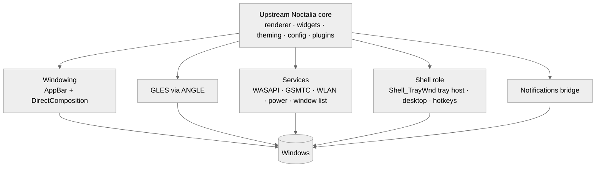

<!-- Copyright (c) 2026 Damian Daniel <damiand@fedoraproject.org> and contributors. MIT License. -->
<h1 align="center">noctalia-windows</h1>

<p align="center">
  <b>Noctalia as a real Windows shell.</b><br>
  Same look. Same feel. New insides.
</p>

<p align="center">
  <a href="https://github.com/damiandaniel/noctalia-windows/actions/workflows/ci.yml"></a>
  
  
</p>

> **Status: just starting.** This is a personal experiment. It is not an official
> [Noctalia](https://github.com/noctalia-dev) project. You can't use it as a desktop yet,
> and things will break. Please read [docs/dev-environment.md](docs/dev-environment.md)
> before you change any shell settings.

## Why

Windows never had one shell that feels made as a whole. There are good tools: Rainmeter, YASB,
ExplorerPatcher, Windhawk and Komorebi. Older shell replacements like LiteStep, bblean and Cairo
came before them. But none of it feels like one finished desktop.

Noctalia v5 is written in C++ and does not use Qt. It draws everything itself with OpenGL ES, and
you set it up with one TOML file. That helps a lot, because how Noctalia looks does not depend on a
toolkit. The parts that only work on Linux sit lower down: Wayland, layer-shell, PipeWire, D-Bus
and the talk with the compositor. Those are the parts this project swaps out.

## Goals

- Look and act the same as Noctalia on Linux.
- Be a real shell. Noctalia is set as the Windows shell. It owns the tray, the desktop and the
  panels. It does not sit on top of Explorer.
- Stay close to upstream. Windows code lives in its own folder, so new Noctalia releases are easy
  to pull in. Anything that is not Windows-only goes back upstream.
- Keep the TOML config, IPC and plugins working the same way.

## Not goals

- A mode that runs on top of Explorer's taskbar.
- A new lock screen or login screen. Windows needs a special login plugin for that, which is a
  separate project.
- Umbriel (the compositor) and Noctalia Greeter.
- Patching or hooking `explorer.exe`.

## How it works



For more detail, and the full list of what maps to what, see [docs/architecture.md](docs/architecture.md).

## Roadmap

The full list is in [docs/roadmap.md](docs/roadmap.md).

- [ ] **M0: Probes.** Small tests for the things the plan depends on (shell role, tray, notifications).
- [ ] **M1: Drawing.** The upstream bar in a see-through window, using ANGLE and DirectComposition.
- [ ] **M2: Services.** Sound, media, power, network, window list.
- [ ] **M3: Shell role.** Winlogon shell, tray, desktop, hotkeys.
- [ ] **M4: Notifications.**
- [ ] **M5: Finish.** Installer, typing in other languages, screen readers, many monitors, DPI.

## What's in the repo

```
.
├── docs/              how it is built, dev setup, roadmap
├── probes/            small programs that test our guesses about Windows
│   ├── shell_probe/   who is the shell right now?
│   └── tray_probe/    a fake tray window that prints what apps send it
├── scripts/           set and undo a per-user test shell
└── .github/workflows/ CI
```

Upstream Noctalia will be added as a submodule once we know where the Windows code plugs in.

## Building

You need Windows 10 or 11, Visual Studio 2022 (or just the Build Tools), and CMake 3.24 or newer.

```powershell
cmake -S . -B build
cmake --build build --config Release
.\build\probes\Release\shell_probe.exe
```

## Test safely

Don't try shell replacement on your main account. Use a spare local user or a VM.
The steps, and how to get back if it breaks, are in [docs/dev-environment.md](docs/dev-environment.md).

## Contributing

Ideas, issues and test results are welcome. Results from different Windows 10 and 11 builds help
most, because the shell acts a bit differently from build to build. If this works out, the repo
may move to the [noctalia-dev](https://github.com/noctalia-dev) organization.

## License

[MIT](LICENSE), the same as upstream Noctalia.

## Thanks

- [Noctalia](https://github.com/noctalia-dev) and the people who build it.
- [ANGLE](https://chromium.googlesource.com/angle/angle), which makes GLES work well on Windows.
- LiteStep, bblean and Cairo Shell, for many years of work on Windows shell replacements.
